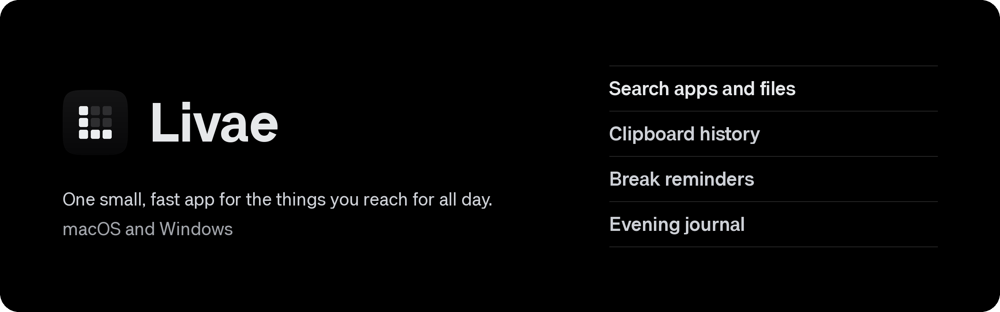
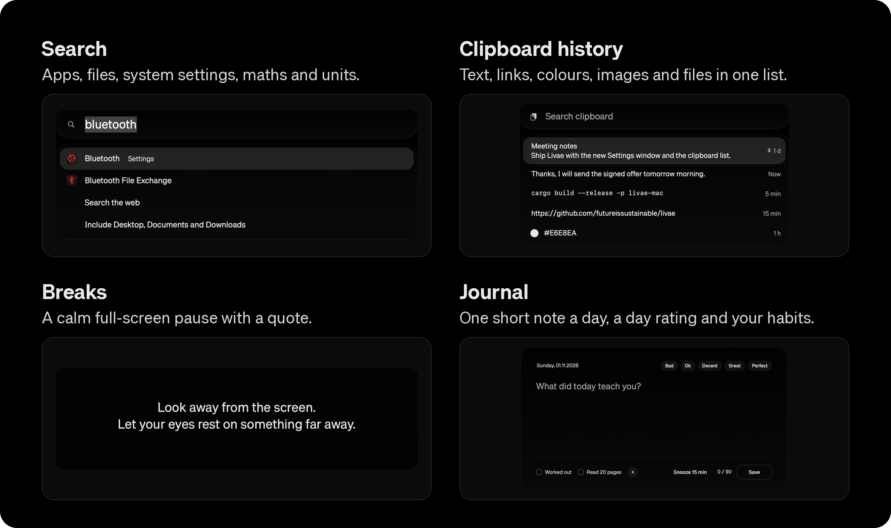

<p align="center"></p>

Written in Rust, native on macOS (Liquid Glass) and Windows 11, true black and quiet by default.

<p align="center"></p>

## What it does

- **Search** (Opt+Space on the Mac, Alt+Space on Windows): apps, files, system settings, maths and units. Enter opens, Cmd/Ctrl+Enter
  shows the file in its folder. Drag a row out: an app lands as a shortcut, a file as your file manager would move it,
  and the Trash takes either (on Windows, files only).
- **Money and time**: `100 eur to ron` at the European Central Bank's daily rates (kept on disk, so it works
  offline), `time in tokyo`, `10am london` in your time, `9:30 pst to berlin`. Enter copies the answer.
- **Commands**: lock, sleep, turn off displays, restart, shut down, log out, empty the trash, toggle dark mode,
  quit or force quit the app in front. Ones that lose work ask for a second Enter.
- **Window manager**: halves, thirds, two thirds, quarters, maximize, center, next display and restore for the window
  in front, from search or your own shortcuts.
- **Quicklinks**: a keyword, a space and words (`gh livae`, `yt lofi`, `maps cluj`) search that site. Add your own.
- **Text expansion** (off until you turn it on), as in Espanso: type `:date`, `:time` or your own trigger in any app
  and it becomes the text. Snippets can hold the date, the time, the copied text and where the cursor ends.
- **Sound**: list your outputs and microphones in order, and whenever a device comes or goes the first one connected
  is put in use. An equaliser per output (and one for every output): a 10-band EQ, AutoEq filters you can import, a
  boost and a limiter that keeps it from clipping, with the curve drawn live. On the Mac it runs inside Livae, with no
  driver: macOS asks once to let Livae hear what apps play, and for an output that has a microphone (a headset, a
  USB DAC) also for the microphone, which Livae keeps off. On Windows it drives
  [Equalizer APO](https://sourceforge.net/projects/equalizerapo/), which you install once and add to each output in
  its Configurator; the tray says when the output in use still needs it.
- **Clipboard history** (Shift+Cmd+C, Win+Shift+V): text, links, colours, images and files in one list, opened at your
  text cursor. Pin what you keep; copies from password managers are never recorded.
- **Breaks** (off until you turn them on): a calm full-screen pause with a quote, on a Stretchly-like schedule, that
  waits while you are away, presenting or in Do Not Disturb.
- **Journal** (off until you turn it on): one short note a day, a day rating and your own habit check-ins with streaks,
  written to a plain Markdown file you choose. Compatible with Vesper's format.
- **Year view**: every day of the year as a square, by mood or by habits done; point at a day or a colour to
  light the matching days.
- **Livae for Zen** (optional browser extension in `extensions/livae-for-zen`): a short wait and a quote before distracting
  sites. With Livae installed it takes its sites, waits and quotes from Livae.


## Upcoming

- **Focus**: block distracting apps and sites across the whole system for a session, not only in the browser as
  Livae for Zen does today.

Well-made pull requests are welcome for this and anything in the same spirit; see `CONTRIBUTING.md`.

## Install

Download the Mac (Apple silicon) and Windows builds from [Releases](https://github.com/futureissustainable/livae/releases). Livae is not code-signed. Your system asks once before the first launch:

- **macOS:** move `Livae.app` to Applications and open it. If macOS says it cannot verify the developer, open
  **System Settings → Privacy & Security** and choose **Open Anyway**. Paste-into-app needs **Accessibility**
  permission; file search outside your home folder needs folder access (Livae asks).
- **Windows:** run `livae.exe`. If SmartScreen appears, choose **More info → Run anyway**. Livae starts with Windows
  through a shortcut in your Startup folder.

## Settings

Everything is in one file (the Mac also has a Settings window):

- macOS: `~/Library/Application Support/Livae/settings.toml`
- Windows: `%APPDATA%\Livae\settings.toml`

Shortcuts, glass darkness, clipboard size, ignored apps, the `[breaks]` and `[journal]` tables (`enabled = true` to
turn them on) and Livae for Zen's sites all live there. Break quotes are in `quotes.md` next to it. A saved edit
applies within a few seconds.

```toml
currency = "RON"          # what money answers convert to when none is named; empty: your region's
expansion = true          # text expansion on

[[snippets]]
trigger = ";sig"
text = "Best,\nAna{cursor}"   # also {date}, {date:%A}, {time}, {clipboard}

[[quicklinks]]
name = "Crates"
keyword = "cr"
url = "https://crates.io/search?q={query}"

[hotkeys]                 # any command by id, see the comment at the top of the file
left-half = "Ctrl+Opt+Left"
right-half = "Ctrl+Opt+Right"
lock-screen = "Hyper+L"
```

## Build

```sh
cargo test -p livae-core
# macOS (Apple Silicon): builds and installs ~/Applications/Livae.app
bash scripts/build-mac.sh
# Windows, natively or cross-compiled from Linux with mingw-w64:
cargo build --release -p livae-win --target x86_64-pc-windows-gnu
```

`livae-core` holds the shared logic (search ranking, clipboard history, break scheduler, journal format, settings);
`livae-mac` (objc2) and `livae-win` (windows-rs, Direct2D) are the native front ends. Design rules: `DESIGN.md`.

## Credits

- App discovery and unit-conversion ideas from [RustCast](https://github.com/MystikoLab/rustcast) (MIT, see
  `THIRD_PARTY_RUSTCAST_LICENSE.md`).
- Livae Sans, the app's typeface (SIL Open Font License, `assets/fonts/OFL.txt`), is a modified version of Host Grotesk,
  Geist, Schibsted Grotesk, Inter Tight, Archivo and Funnel Sans, all under the same licence.

## Licence

MIT, see `LICENSE`.
