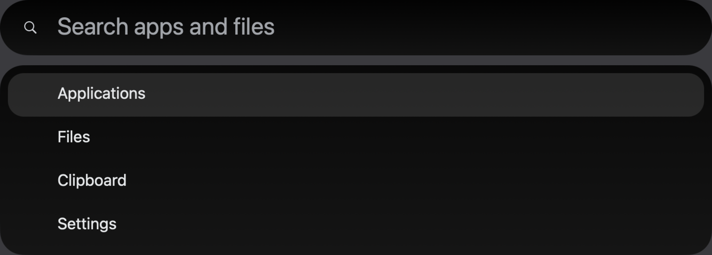
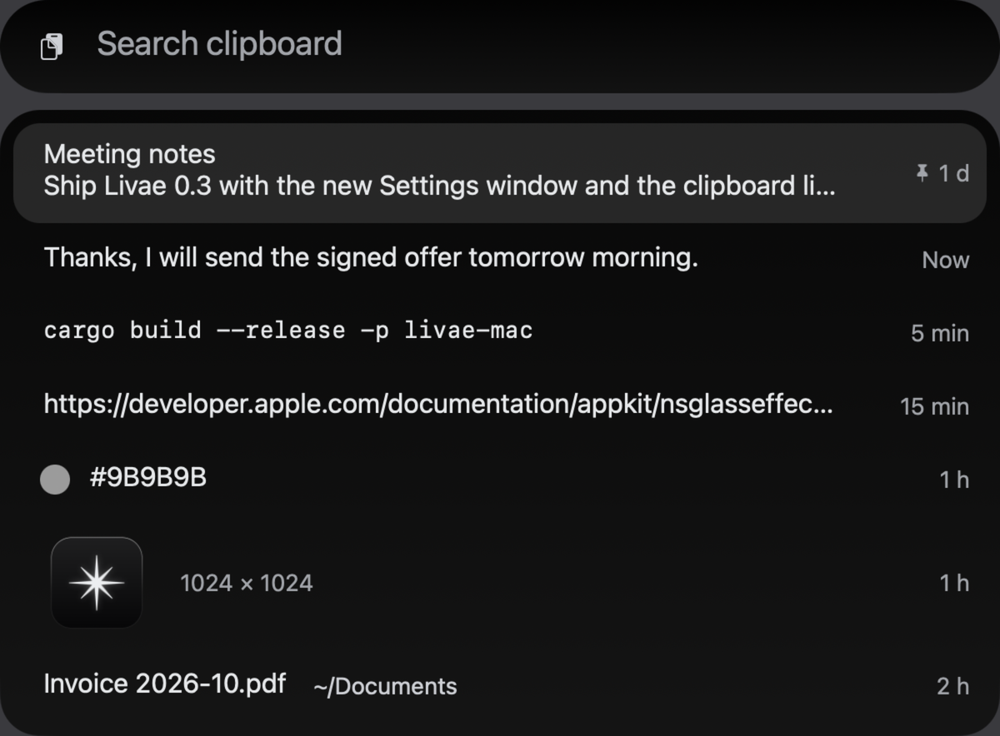
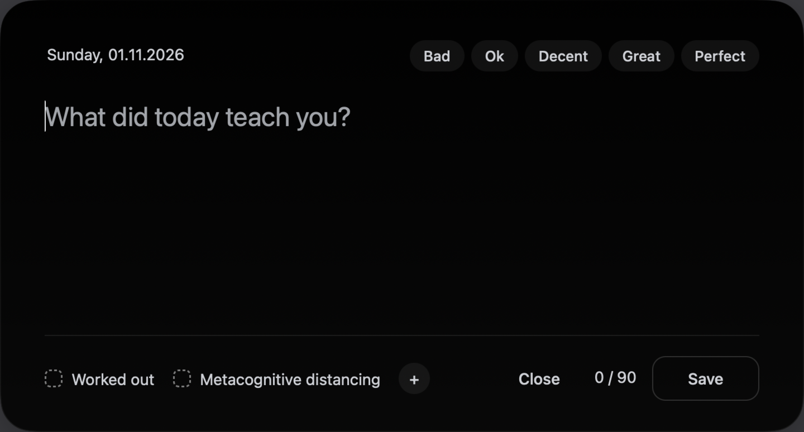
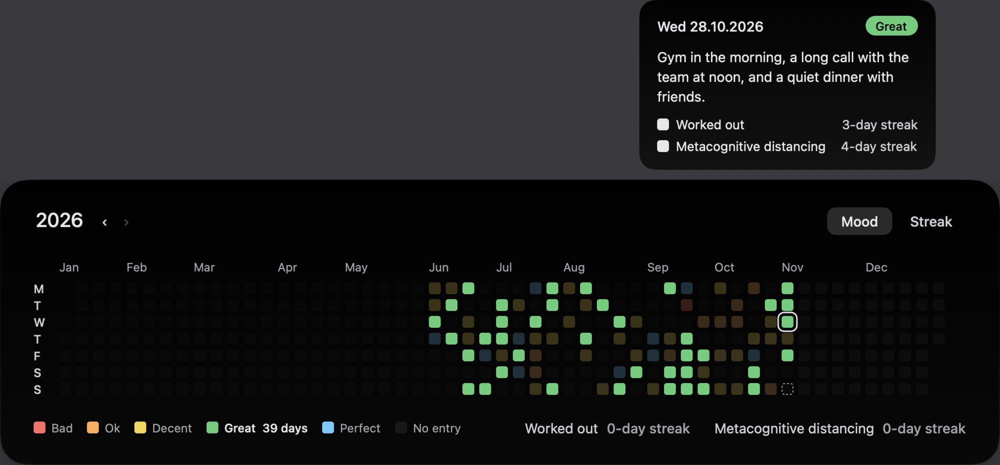

# Livae

One small, fast app for the things you reach for all day: a launcher, a clipboard history, break reminders and an
evening journal. Written in Rust, native on macOS (Liquid Glass) and Windows 11, true black and quiet by default.



## What it does

- **Search** (Opt+Space on the Mac, Alt+Space on Windows): apps, files, maths and units. Enter opens, Cmd/Ctrl+Enter
  shows the file in its folder.
- **Clipboard history** (Shift+Cmd+C, Win+Shift+V): text, links, colours, images and files in one list, opened at your
  text cursor. Pin what you keep; copies from password managers are never recorded.
- **Breaks** (off until you turn them on): a calm full-screen pause with a quote, on a Stretchly-like schedule, that
  waits while you are away, presenting or in Do Not Disturb.
- **Journal** (off until you turn it on): one short note a day, a day rating and your own habit check-ins with streaks,
  written to a plain Markdown file you choose. Compatible with Vesper's format.
- **Year view** (macOS): every day of the year as a square, by mood or by habits done; point at a day or a colour to
  light the matching days.
- **Zen Gate** (optional browser extension in `extensions/zen-gate`): a short wait and a quote before distracting
  sites. With Livae installed it takes its sites, waits and quotes from Livae.





## Install

Livae is not code-signed. Your system asks once before the first launch:

- **macOS:** move `Livae.app` to Applications and open it. If macOS says it cannot verify the developer, open
  **System Settings → Privacy & Security** and choose **Open Anyway**. Paste-into-app needs **Accessibility**
  permission; file search outside your home folder needs folder access (Livae asks).
- **Windows:** run `livae.exe`. If SmartScreen appears, choose **More info → Run anyway**. Livae starts with Windows
  through a shortcut in your Startup folder.

## Settings

Everything is in one file (the Mac also has a Settings window):

- macOS: `~/Library/Application Support/Livae/settings.toml`
- Windows: `%APPDATA%\Livae\settings.toml`

Shortcuts, glass darkness, clipboard size, ignored apps, the `[breaks]` and `[journal]` tables (`enabled = true` to
turn them on) and Zen Gate's sites all live there. Break quotes are in `quotes.md` next to it.

## Build

```sh
cargo test -p livae-core
# macOS (Apple Silicon): builds and installs ~/Applications/Livae.app
bash scripts/build-mac.sh
# Windows, natively or cross-compiled from Linux with mingw-w64:
cargo build --release -p livae-win --target x86_64-pc-windows-gnu
```

`livae-core` holds the shared logic (search ranking, clipboard history, break scheduler, journal format, settings);
`livae-mac` (objc2) and `livae-win` (windows-rs, Direct2D) are the native front ends. Design rules: `DESIGN.md`.

## Credits

- App discovery and unit-conversion ideas from [RustCast](https://github.com/MystikoLab/rustcast) (MIT, see
  `THIRD_PARTY_RUSTCAST_LICENSE.md`).
- Livae Sans, the app's typeface (SIL Open Font License, `assets/fonts/OFL.txt`), is a modified version of Host Grotesk,
  Geist, Schibsted Grotesk, Inter Tight, Archivo and Funnel Sans, all under the same licence.
- Zen Gate shows digits in [Departure Mono](https://departuremono.com) (SIL Open Font License).

## Licence

MIT, see `LICENSE`.
